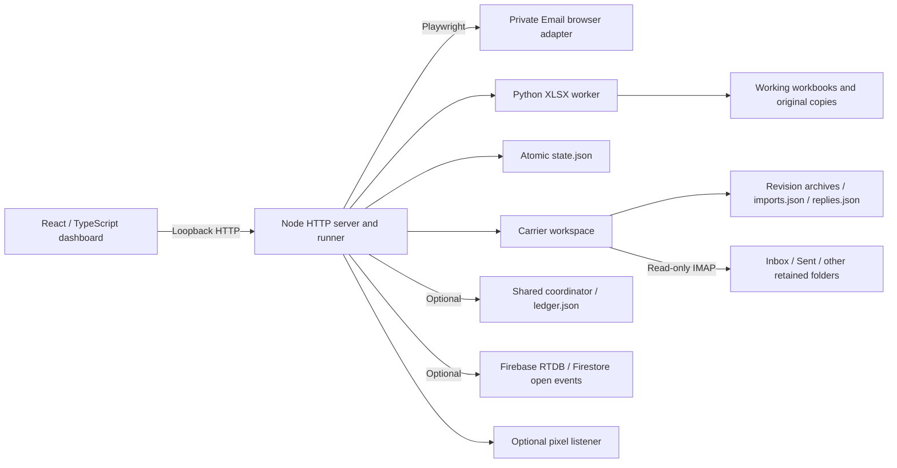

# Outreach Desk — end-to-end product audit

**Audit date:** November 3, 2026, Asia/Karachi.  
**Audited checkout:** `feat/bauhaus-saas-ui-revamp`, commit `3aca754f4f3e9dcd8ad6d7c9247e961da50af46a`.  
**Application label:** `0.1.0-alpha.1`, internal testing.  
**Scope:** Product, architecture, sending, workbook/import integrity, conversations, UI/UX, security, operations, tests and release readiness.  
**Changes:** This report is the only repository addition. No application code, dependencies, production state, mailbox configuration or live mail was changed.

## 1. Assessment and recommended decision

Outreach Desk is an advanced internal alpha with a useful, coherent core: help a small logistics sales team import carrier leads, send controlled personalized outreach, avoid duplicate contact, inspect evidence, and manage resulting conversations. It is already substantially more capable and better guarded than a simple spreadsheet mail merge. It has a polished shared interface, meaningful regression coverage, durable send intent, conservative uncertainty handling, reviewed workbook revisions, and explicit human approval for replies.

**It is suitable for supervised internal evaluation. It should not yet be treated as an unattended, generally production-ready shared-team product.** Two reproduced integrity failures warrant release-blocking treatment: campaign cleanup can remove effective opt-out protection, and failed campaign deletion can leave saved state referencing an already deleted workbook. Other important gaps occur where separate workflows meet: manual versus automated pacing, local versus shared protection, startup versus background refresh, source recovery versus approval, and one browser window versus another.

The highest-value direction is to make those boundaries consistent and recoverable, then complete the daily sales workflow. More dashboards, more automation, or a wholesale rewrite would not address the most important weaknesses.

### Evidence language

- **Verified defect:** Reproduced through synthetic HTTP, browser or in-memory checks, or directly established by an executable code path. Reproductions never submitted real mail.
- **Risk:** The implementation exposes a plausible failure mode; its occurrence or impact at production scale was not demonstrated.
- **Enhancement:** A missing or incomplete capability with a product rationale, rather than a claim of broken existing behavior.
- **Conditional:** Priority depends on deployment mode, such as shared mailboxes or OAuth-backed capture.

P0 means an integrity/security failure or release blocker; P1 means essential reliability or product completeness; P2 means a substantial quality improvement; P3 means an optional later opportunity. Complexity is relative implementation effort, not a calendar commitment. The report contains **46 findings: 2 P0, 17 P1, 23 P2 and 4 P3**. These are prioritized work items, not 46 independently exploitable vulnerabilities.

### Current strengths to preserve

1. [src/delivery.mjs:20–42](/Users/bukhtyarhaider/Projects/Client/email-automation-fclogistics/src/delivery.mjs:20) persists send intent before invoking submission. Ambiguous outcomes are blocked from automatic retry, including after restart.
2. [src/browser.mjs:299–360](/Users/bukhtyarhaider/Projects/Client/email-automation-fclogistics/src/browser.mjs:299) verifies subject, inserted body, signature, committed recipient count and a fresh success notice. Saved browser profiles are isolated; CDP endpoints are restricted to loopback.
3. [src/state-file.mjs:12–38](/Users/bukhtyarhaider/Projects/Client/email-automation-fclogistics/src/state-file.mjs:12) serializes writes and uses flushed atomic replacement. Reviewed imports add immutable source/revision evidence, hashes and explicit activation/Undo.
4. Captured opt-outs are saved locally before retrying coordinator delivery. Read-only IMAP uses TLS with certificate verification.
5. Reply approval normally binds exact text, account, recipient, subject and evidence context. Operator-reported sending, matching Sent copies and delivery evidence remain distinct.
6. Firebase recovery retains original-token ownership checks, durable receipts and save-before-acknowledge behavior. History CSV protects against formula injection.
7. The main server binds to `127.0.0.1`, validates Host and POST Origin/custom headers, serves an explicit static allowlist and applies a restrictive CSP. React renders untrusted text safely. No remote unauthenticated code-execution or cross-site write exploit was established in this audit.
8. The current interface already provides shared navigation/components, useful empty states, native dialogs, settings search and change review, retained in-app drafts, and responsive screens. This is a refinement task, not grounds for another cosmetic rebuild.

## 2. What the product currently is

### Users, value and operating model

The primary users are logistics/dispatch sales operators working from individual PCs and mailbox profiles. A manager may coordinate several installations. The immediate business problem is turning workbook leads into disciplined outreach and actionable carrier conversations without duplicate sends, fabricated personalization or loss of contact history.

The intended journey is:

1. Install local dependencies and launch the loopback dashboard.
2. Configure a mailbox profile and business identity, then verify the browser mailbox connection.
3. Upload a workbook, review mappings/provenance, save a revision, activate it and enable campaign participation.
4. Inspect eligibility and rendered wording; start a selected batch or continuous campaign rotation.
5. Observe pacing, send outcomes, uncertain attempts, workbook synchronization and tracking evidence.
6. Separately authorize read-only Inbox/Sent capture; review matching/classification and carrier-stated details.
7. Write a reply, review and approve its exact text, copy it, open the native mailbox, send manually, and optionally record that action.
8. Maintain carrier stages and follow-up dates, inspect reporting, back up, update and recover the installation.

This journey makes sense, but steps 2/6, 3/4, 5/7 and 8 are only partially integrated. A connected sending browser is not a healthy reply-capture connection. An email address protected by a workbook should remain protected when that workbook is removed. A local reply stage is not shared team ownership. A reporting export is not a restorable backup.

### Architecture and data ownership

- **Frontend:** React 19 and strict TypeScript; esbuild; design-system primitives; persistent page tree and imperative feature controllers that update React portal regions. There are 135 frontend files under the reviewed UI directories. All views remain mounted to preserve in-app state.
- **Application:** A single local Node process. [src/server.mjs](/Users/bukhtyarhaider/Projects/Client/email-automation-fclogistics/src/server.mjs) combines routing, mutable state, operation locking, sending orchestration, campaign caches, startup and shutdown. A global `busy` flag serializes most POST operations; capture and background workers also operate asynchronously.
- **Workbook storage:** A Python standard-library ZIP/XML implementation, not a runtime openpyxl dependency. Workbooks are copied and surgically patched. The parser limits declared uncompressed ZIP size to 150 MB.
- **Database:** There is no relational application database. `state.json` owns profiles, campaign pointers, sending history, suppression, pacing and tracking. `carrier-workspace` owns import revisions, identities, captured messages, drafts, approvals and workflow history. The optional coordinator has a separate JSON ledger. Firebase stores remote open-event telemetry.
- **Transport:** The normal outbound adapter supports the inspected Private Email UI. Changing a mailbox URL does not create a new provider adapter. Conversation replies are intentionally sent by the human in the original mailbox.
- **Deployment:** Portable ZIP plus Node/Python/browser setup on each PC. No installed background service, integrated updater or complete backup/restore feature. `.env`, browser profiles and local data remain installation-specific.

**Architectural judgment:** This stack is reasonable for a low-volume, local operator tool. Retain the local-first model, immutable import archives and guarded sending. Extract services and improve indexed persistence in measured steps. A distributed rewrite, multiple microservices or a generic CRM rebuild would add cost before resolving current integrity issues.

## 3. Verification performed and limits

| Check | Result and practical meaning |
| --- | --- |
| Existing JavaScript suite | **232/232 passed**, no failures or skips, with `FC_BROWSER_TESTS=1 node scripts/test.mjs`. Includes real Chrome against synthetic local fixtures. |
| Existing Python suite | **12/12 passed**. |
| Strict frontend types | `npm run typecheck` passed. |
| Frontend format | `npm run format:check` passed. |
| Production UI build | Built in a temporary source copy; all 10 compared generated JS/CSS/HTML/icon files matched the checked-in assets byte for byte. The repository build output was not rewritten. |
| Dependency vulnerability query | Fresh `npm audit --omit=dev --ignore-scripts --json`: **10 moderate affected package entries, 0 high, 0 critical**. Some entries represent propagation of the same advisory through a chain. |
| Additional sending/data reproductions | Fake-mail HTTP checks reproduced lost suppression after deletion, import-order dependence, minimum-gap bypass, coordinator-dependent local suppression and unlink-before-save failure. |
| Additional browser checks | Reproduced startup polling failure, focus loss, campaign-edit loss and template loss on reload. No document-level horizontal overflow in **39 combinations: 13 routes × 1280/768/390 px**. |
| Additional parser/capture/approval checks | In-memory checks reproduced missed stop requests, skipped monitoring UIDs, follow-up eligibility without capture coverage, and retained approval after original-body recovery. |
| Launcher identity check | A temporary lock pointing at an audit-owned unrelated child caused the launcher to terminate that child. No unrelated user process was targeted. |
| Worktree protection | Existing tests used synthetic temporary data. No live sends, production mailbox access, production-state writes, dependency installation, merge, commit or deployment. |

The complete test run took approximately 163 seconds for JavaScript. It passed because the newly identified boundary cases are not represented by the current assertions. A green baseline is useful evidence, not evidence that the new findings are false.

The audit inspected source, tests, build/launch/package/CI configuration, README, validation and recovery guides, and representative desktop/mobile screenshots. It did not run an exhaustive manual interaction matrix for every control, perform screen-reader certification, stress-test large inboxes, verify current hosted Firebase rules/collector code, or execute on native Windows/Edge. Historic validation notes contain useful targeted live-mailbox evidence, but do not establish acceptance of every flow in this exact checkout. Actual remote CI results were not fetched. Dependencies were checked for advisories; there was no indiscriminate attempt to update every package to its newest version.

Temporary raw logs are available for the current session at `/tmp/outreach-audit-tests-full.log` and `/tmp/outreach-dependency-audit.json`; `/tmp` is not durable evidence storage. Synthetic reproduction steps are described with the findings below.

## 4. P0 — Critical integrity fixes

### A01. Campaign cleanup can remove an opt-out block from another campaign

**Priority:** P0. **Complexity:** Medium. **Evidence:** Verified HTTP reproductions, including reviewed imports.

- **Current state:** `candidates()` constructs cross-campaign protections from currently loaded workbook rows. Reviewed-import protections are copied into cached leads during `enrich()`. The immediate carrier guard primarily covers captured reply holds.
- **Problem:** Protection depends on the continued existence of the originating campaign and on import/reload order. With the same email in an unsubscribe workbook and a ready workbook, deleting the former made the latter eligible. Reviewing the ready campaign before the opt-out campaign reproduced a temporary loss even when both were reviewed; reloading then restored the archived block. Reviewing only the ready campaign left the loss after reload. A direct legacy-row delete endpoint produced a similar loss; the normal UI disables selection of excluded rows.
- **Recommended solution:** Store discovered contact protections in a durable global ledger independent of campaign/file lifecycle. Preserve source and reason; distinguish opt-out, prior contact, bounce and uncertainty. Consult it on every eligibility check and immediately before submission. Publish a protection generation and invalidate every affected campaign cache when it changes. Deletion/mapping/revision changes must not reduce protection implicitly.
- **Expected impact:** Routine cleanup can no longer make a known protected recipient sendable. This is foundational to operator trust and team expansion.
- **Affected areas:** [src/server.mjs:346–377](/Users/bukhtyarhaider/Projects/Client/email-automation-fclogistics/src/server.mjs:346), [src/server.mjs:1200–1258](/Users/bukhtyarhaider/Projects/Client/email-automation-fclogistics/src/server.mjs:1200), [src/carrier-workspace.mjs:108](/Users/bukhtyarhaider/Projects/Client/email-automation-fclogistics/src/carrier-workspace.mjs:108), [src/carrier-workspace.mjs:243–257](/Users/bukhtyarhaider/Projects/Client/email-automation-fclogistics/src/carrier-workspace.mjs:243), [src/carrier-identity.mjs:11–25](/Users/bukhtyarhaider/Projects/Client/email-automation-fclogistics/src/carrier-identity.mjs:11).

**Acceptance:** Reproduce both review orders, legacy/current campaigns, deletion of campaign/row, missing source file, reload and restart. The recipient remains protected throughout, including at the final send gate. Explicit reviewed resolution, rather than deletion, is the only way to change a protection.

### A02. Failed campaign deletion can leave saved state pointing at a deleted workbook

**Priority:** P0. **Complexity:** Medium. **Evidence:** Verified fault-injection reproduction.

- **Current state:** The delete handler removes a campaign in memory, unlinks its workbook and only then persists the updated state.
- **Problem:** In an isolated workspace, making `state.json.tmp` unwritable caused deletion to return HTTP 400 while disk state still contained the campaign and its referenced workbook was already gone. A crash in the same window creates the same inconsistency. Original/revision backups may permit manual recovery, but the active working copy and its later status changes are not guaranteed recoverable from those copies alone.
- **Recommended solution:** Implement a durable deletion record/tombstone and reversible Trash lifecycle. Publish the new campaign state before physical cleanup; journal file moves so restart can finish or roll back. Retain send/protection evidence independently. Reclaim storage after a retention period, not during an uncommitted mutation.
- **Expected impact:** Failed requests and crashes no longer corrupt the saved workspace; accidental cleanup becomes recoverable.
- **Affected areas:** [src/server.mjs:1200–1228](/Users/bukhtyarhaider/Projects/Client/email-automation-fclogistics/src/server.mjs:1200), [src/state-file.mjs:12–38](/Users/bukhtyarhaider/Projects/Client/email-automation-fclogistics/src/state-file.mjs:12), campaign deletion UI and missing-workbook recovery.

**Acceptance:** Inject failure before/after each state and file step. After restart, either the campaign remains usable or a completed deletion is recoverable from Trash. No published pointer references an already destroyed file.

## 5. P1 — Essential reliability and product completeness

### A03. Manual sending bypasses the configured minimum interval

**Priority:** P1. **Complexity:** Low. **Evidence:** Verified fake-mail HTTP reproduction.

- **Current state:** `sendPrepared()` checks hourly/daily quota but does not apply the minimum-interval gate used by the queue. Shared coordination may impose its own interval, but independent-PC mode does not.
- **Problem:** With `minSeconds=180`, two manual prepare/send cycles recorded attempts only **98 milliseconds apart**. A setting presented as mailbox pacing is therefore action-dependent.
- **Recommended solution:** Put local/shared minimum interval and allowance checks in one central send gate used by manual, selected, continuous and seed flows. Return a structured wait reason and `retryAt`; show it beside Send. Preserve the separately confirmed hard-reset behavior.
- **Expected impact:** All app sending paths honor the policy users configured.
- **Affected areas:** [src/server.mjs:447–455](/Users/bukhtyarhaider/Projects/Client/email-automation-fclogistics/src/server.mjs:447), [src/server.mjs:1369–1404](/Users/bukhtyarhaider/Projects/Client/email-automation-fclogistics/src/server.mjs:1369), [src/pacing.mjs:44–62](/Users/bukhtyarhaider/Projects/Client/email-automation-fclogistics/src/pacing.mjs:44).

### A04. Manual Do Not Contact is not local-first; removal can report false shared success

**Priority:** P1. **Complexity:** Low–Medium. **Evidence:** Verified add failure; source-verified removal behavior.

- **Current state:** `/api/suppress` calls the coordinator before saving local suppression. `/api/unsuppress` deletes local/snapshot entries, catches a shared failure and still returns success. Captured opt-outs already use a stronger durable outbox.
- **Problem:** With an unavailable coordinator, a manual addition returned `fetch failed` and the address remained absent from local suppression. Removal can appear completed while the coordinator still blocks the address, then reappear on the next snapshot. Neither direction provides a coherent shared status.
- **Recommended solution:** Durably save local additions immediately and enqueue idempotent shared delivery. For removals, retain a pending reviewed request until shared acknowledgment; accurately report local/shared scope and prohibit captured-opt-out overrides. Reuse the existing captured-protection outbox design.
- **Expected impact:** Opt-out additions take effect on this PC during outages, and pending shared removals are reported accurately.
- **Affected areas:** [src/server.mjs:1419–1449](/Users/bukhtyarhaider/Projects/Client/email-automation-fclogistics/src/server.mjs:1419), [src/carrier-workspace.mjs:109–137](/Users/bukhtyarhaider/Projects/Client/email-automation-fclogistics/src/carrier-workspace.mjs:109), Do Not Contact UI.

### A05. Common explicit stop requests are not recognized as opt-outs

**Priority:** P1. **Complexity:** Medium. **Evidence:** Verified parser-to-draftability reproductions.

- **Current state:** The rule set recognizes narrow affirmative patterns. “Please unsubscribe.”, “Please stop.”, “Do not send me any more emails.” and “Remove my company from your list.” return `unclassified`.
- **Problem:** Exact-reference synthetic messages containing the first and third phrases produced no protection, `hold:null`, `needsReply:true`, and allowed reply drafting. Final sending is still human-controlled, so this is not automatic unwanted sending, but the protection promise is incomplete.
- **Recommended solution:** Add conservative affirmative stop-language rules and clause-local negation. Add a possible-opt-out review hold for ambiguous stop language; preserve quote/negation safeguards. Test short requests, mixed clauses, signatures and HTML/plain variants. Keep ordinary disinterest separate from a permission withdrawal.
- **Expected impact:** Fewer unwanted replies and less dependence on the operator noticing a classifier miss.
- **Affected areas:** [src/reply-parser.mjs:22–34](/Users/bukhtyarhaider/Projects/Client/email-automation-fclogistics/src/reply-parser.mjs:22), [src/experiment-replies.mjs:57–68](/Users/bukhtyarhaider/Projects/Client/email-automation-fclogistics/src/experiment-replies.mjs:57), [src/conversation-assistant.mjs:136](/Users/bukhtyarhaider/Projects/Client/email-automation-fclogistics/src/conversation-assistant.mjs:136).

### A06. Delivery monitoring advances past unavailable message evidence

**Priority:** P1. **Complexity:** Low. **Evidence:** Verified in-memory IMAP mocks; real provider incidence unmeasured.

- **Current state:** `MailboxMonitor.scan()` advances/persists a UID when metadata is null or a source fetch has no `.source`, without a review item.
- **Problem:** Both synthetic branches committed UID 17 and an empty review map. A transient fetch anomaly is treated like completed processing, so DSN or Sent reconciliation evidence may never be retried.
- **Recommended solution:** Reuse ReplyCapture’s stronger pattern: verify that the UID was actually expunged before advancing; otherwise retain the cursor, expose incomplete/retry status and retry safely. Share the cursor correctness contract between the two scanners.
- **Expected impact:** Avoids silently skipping bounce/Sent evidence during transient fetch failures.
- **Affected areas:** [src/mailbox-monitor.mjs:123–146](/Users/bukhtyarhaider/Projects/Client/email-automation-fclogistics/src/mailbox-monitor.mjs:123), existing stronger reference [src/reply-capture.mjs:76–91](/Users/bukhtyarhaider/Projects/Client/email-automation-fclogistics/src/reply-capture.mjs:76).

### A07. A single startup API failure can permanently prevent status polling

**Priority:** P1. **Complexity:** Low–Medium. **Evidence:** Verified Chrome reproduction.

- **Current state:** `mountBoot()` awaits state, leads, history and optional page loads before installing its interval. The outer catch displays a notice.
- **Problem:** One synthetic `/api/history` 503 left state/history request counts at one after 4.2 seconds; removing the error and waiting another 1.8 seconds did not recover. The UI can remain stale while the runner continues independently.
- **Recommended solution:** Install resilient state polling independently of optional feature initialization. Isolate feature errors, add retry controls, show last successful refresh and stale status, and recover automatically after service restoration.
- **Expected impact:** Accurate operation status and a usable dashboard despite a reporting-page failure.
- **Affected areas:** [src/ui/app/runtime/polling.ts:12–43](/Users/bukhtyarhaider/Projects/Client/email-automation-fclogistics/src/ui/app/runtime/polling.ts:12), [src/ui/app/bootstrap.ts:41–43](/Users/bukhtyarhaider/Projects/Client/email-automation-fclogistics/src/ui/app/bootstrap.ts:41).

### A08. Normal polling removes keyboard focus from table actions

**Priority:** P1. **Complexity:** Medium. **Evidence:** Verified Chrome reproduction.

- **Current state:** Each 1.5-second refresh redraws several lists. `renderRegion()` increments a Fragment key, remounting descendant controls even when data is unchanged.
- **Problem:** Focusing Templates Edit or Accounts Edit resulted in `BUTTON → BODY` after 1.8 seconds. Keyboard interaction and assistive-technology context are unstable. Similar replacement exists in suppression/recovery regions; those specific controls were not separately reproduced.
- **Recommended solution:** Skip rendering unchanged data, retain stable keyed row/control identities and update only changed status content. Do not use replacement revision keys for normal polling. Test keyboard focus across multiple refreshes and actual data changes.
- **Expected impact:** Reliable keyboard operation, less DOM work and a more professional daily experience.
- **Affected areas:** [src/ui/app/runtime/refresh.tsx:164–169](/Users/bukhtyarhaider/Projects/Client/email-automation-fclogistics/src/ui/app/runtime/refresh.tsx:164), [src/ui/shared/regions.tsx:33–65](/Users/bukhtyarhaider/Projects/Client/email-automation-fclogistics/src/ui/shared/regions.tsx:33), template/profile/suppression controllers.

### A09. Hidden preview selection governs real fixed-template queues

**Priority:** P1. **Complexity:** Medium. **Evidence:** Source-verified frontend/backend behavior.

- **Current state:** The single `template` selector is in the lead drawer, labeled “Template for this preview.” Launch controls offer a random checkbox but no explicit fixed-template policy. Batch/continuous start submit that selector’s value.
- **Problem:** Disabling random templates makes the last preview choice govern real sending across enabled campaigns. Previewing content changes the policy used by the next fixed-template launch, which is invisible beside Start. An already running queue retains its stored template key.
- **Recommended solution:** Separate preview choice from sending policy. Display and persist a fixed template or eligible template pool per campaign/launch. Before launch, show a concrete summary of sender, included campaigns, eligible recipients/exclusions, template policy and pacing. Preserve fast repeated use after the policy is explicit.
- **Expected impact:** Prevents wrong-content runs and makes cross-campaign rotation understandable.
- **Affected areas:** [src/ui/app/layout/LeadDrawer.tsx:94–99](/Users/bukhtyarhaider/Projects/Client/email-automation-fclogistics/src/ui/app/layout/LeadDrawer.tsx:94), [src/ui/features/dashboard/DashboardActions.tsx:159–166](/Users/bukhtyarhaider/Projects/Client/email-automation-fclogistics/src/ui/features/dashboard/DashboardActions.tsx:159), [src/ui/features/live-activity/controller.tsx:531–550](/Users/bukhtyarhaider/Projects/Client/email-automation-fclogistics/src/ui/features/live-activity/controller.tsx:531), [src/server.mjs:634–637](/Users/bukhtyarhaider/Projects/Client/email-automation-fclogistics/src/server.mjs:634), [src/server.mjs:715–717](/Users/bukhtyarhaider/Projects/Client/email-automation-fclogistics/src/server.mjs:715).

### A10. Commands and edits need explicit entity/revision binding across browser windows

**Priority:** P1. **Complexity:** Medium. **Evidence:** Source-verified race risk; full multi-window wrong-campaign send not reproduced.

- **Current state:** Prepare/batch resolve lead IDs against global `activeCampaign`. Lead IDs encode worksheet part, row and email, not campaign ID. Settings, profile, campaign and cold-template writes generally lack the optimistic versions already used by conversation workflows. Settings draft merging reduces overwrites but is not an atomic cross-window lock.
- **Problem:** Another window can switch campaign between review and action. The same address at the same row in another workbook can share an ID and resolve to different source/company context. Concurrent editors can also overwrite newer changes.
- **Recommended solution:** Require `campaignId`, mailbox/profile ID and expected workbook/entity version on consequential commands; return 409 on mismatch. Use compare-and-set versions for settings/profile/campaign/template writes, preserving rejected drafts with a reload/merge choice. Bind the launch review to the same snapshot.
- **Expected impact:** Stale views fail visibly instead of acting on a different context or silently overwriting work.
- **Affected areas:** [src/server.mjs:1060–1199](/Users/bukhtyarhaider/Projects/Client/email-automation-fclogistics/src/server.mjs:1060), [src/server.mjs:1260–1404](/Users/bukhtyarhaider/Projects/Client/email-automation-fclogistics/src/server.mjs:1260), [src/server.mjs:1406–1416](/Users/bukhtyarhaider/Projects/Client/email-automation-fclogistics/src/server.mjs:1406), [src/workbook.py:100–102](/Users/bukhtyarhaider/Projects/Client/email-automation-fclogistics/src/workbook.py:100); frontend action callers. Existing precedent: [src/server.mjs:1233–1235](/Users/bukhtyarhaider/Projects/Client/email-automation-fclogistics/src/server.mjs:1233).

### A11. Proactive follow-ups do not require usable mailbox coverage

**Priority:** P1. **Complexity:** Medium. **Evidence:** Verified policy/guard gap; no automatic send occurs.

- **Current state:** Known incomplete historical statuses block follow-up drafting, but missing historical status is allowed. Eligibility does not require enabled capture or a recent successful scan of the relevant mailbox.
- **Problem:** A synthetic older confirmed send with capture disabled, no messages and no historical monitor produced `followUpReady:true` and allowed a proactive draft. “No captured reply” can mean “not checked.” A historic Complete result can also become stale.
- **Recommended solution:** Track coverage per mailbox/folder with successful boundaries and freshness. Require adequate coverage or a deliberate recorded native-mailbox inspection before proactive follow-up. Include that evidence in approval versions. Keep response-to-known-message rules distinct.
- **Expected impact:** Avoids follow-ups over unseen replies or opt-outs and makes eligibility meaningful.
- **Affected areas:** [src/conversation-assistant.mjs:71–82](/Users/bukhtyarhaider/Projects/Client/email-automation-fclogistics/src/conversation-assistant.mjs:71), [src/conversation-assistant.mjs:136](/Users/bukhtyarhaider/Projects/Client/email-automation-fclogistics/src/conversation-assistant.mjs:136), capture health/status and approval UI.

### A12. Remediate reachable parser advisories and triage transitive vulnerabilities

**Priority:** P1. **Complexity:** Medium. **Evidence:** Fresh npm audit plus direct parser reproduction.

- **Current state:** The production lockfile reports 10 moderate affected package entries in `mailparser/nodemailer` and Firebase/Google/uuid chains, with no high/critical entries. This count includes transitive propagation.
- **Problem:** The installed `parseReply()` parsed `From: Victim (x(y) <carrier@example.com>) <attacker@example.net>` as `carrier@example.com`. The maintained Nodemailer advisory describes this nested-comment address-parser discrepancy. The app relies on parsed participants for conversation scope. This proves a parsing defect is reachable; it does not prove provider authentication bypass or automatic outbound compromise. The uuid advisory’s vulnerable buffer-API use was not demonstrated here.
- **Recommended solution:** Upgrade to compatible patched parser dependencies, regression-test all participant/matching/DSN paths and reject/hold ambiguous address forms. Triage actual reachability for each transitive chain and use supported upstream versions or narrowly tested overrides. Do not blindly accept the audit tool’s proposed major-version/downgrade fix. Add scheduled advisory monitoring.
- **Expected impact:** Stronger participant integrity and a documented vulnerability posture.
- **Affected areas:** [package.json:24–32](/Users/bukhtyarhaider/Projects/Client/email-automation-fclogistics/package.json:24), [package-lock.json](/Users/bukhtyarhaider/Projects/Client/email-automation-fclogistics/package-lock.json), [src/reply-parser.mjs:36–56](/Users/bukhtyarhaider/Projects/Client/email-automation-fclogistics/src/reply-parser.mjs:36), [src/mailbox-monitor.mjs:1–64](/Users/bukhtyarhaider/Projects/Client/email-automation-fclogistics/src/mailbox-monitor.mjs:1).

Primary evidence: [Nodemailer nested-comment advisory](https://github.com/nodemailer/nodemailer/security/advisories/GHSA-8c8m-p3m8-cjg8), [uuid buffer-bound advisory](https://github.com/uuidjs/uuid/security/advisories/GHSA-w5hq-g745-h8pq). Headers and display names should remain carrier-reported evidence, not proof of identity.

### A13. Supported runtime requirements admit end-of-life versions

**Priority:** P1. **Complexity:** Low–Medium. **Evidence:** Verified configuration and official lifecycle status.

- **Current state:** Package/doctor/README accept Node 20+ and Python 3.9+. This audit ran on Node 20.20.2 and Python 3.11.4; CI specifies Node 22/Python 3.12.
- **Problem:** As of this audit, Node 20 and Python 3.9/3.10 are end of life. “Or later” also allows unsupported odd Node lines. A passing test on an unsupported runtime does not restore upstream security maintenance.
- **Recommended solution:** Declare a supported runtime matrix, initially supported Node 22/24 LTS patch releases and supported Python versions already exercised by the project. Make doctor check support status/known minimums, not just major >=20; align setup, documentation and CI. Validate upgrades before changing the minimum.
- **Expected impact:** Fewer environment discrepancies and continued upstream security fixes.
- **Affected areas:** [package.json:34–36](/Users/bukhtyarhaider/Projects/Client/email-automation-fclogistics/package.json:34), [scripts/doctor.mjs:3–30](/Users/bukhtyarhaider/Projects/Client/email-automation-fclogistics/scripts/doctor.mjs:3), [README.md](/Users/bukhtyarhaider/Projects/Client/email-automation-fclogistics/README.md), [.github/workflows/test.yml:14–21](/Users/bukhtyarhaider/Projects/Client/email-automation-fclogistics/.github/workflows/test.yml:14).

Primary evidence: [Node release lifecycle](https://nodejs.org/en/about/previous-releases), [Python version lifecycle](https://devguide.python.org/versions/).

### A14. Complete backup, restoration and safe launcher recovery are missing

**Priority:** P1. **Complexity:** Medium–High. **Evidence:** Documented recovery gap; verified launcher identity failure.

- **Current state:** Recovery requires manually copying each PC’s full data and `.env`. Malformed state tells the operator to restore a backup. Reports labels a redacted export “Full history backup.” The launcher treats a live PID in `app.lock` plus a failed HTTP health check as sufficient reason to terminate it, escalating after about three seconds; health is only a page-text check.
- **Problem:** The export cannot restore workbooks, conversations, complete protection/configuration or sessions. Users can lack a usable backup when corruption occurs. A harmless audit-owned unrelated child referenced by a temporary lock was actually terminated by `--close`; PID reuse can produce that situation. Slow real shutdown work can also exceed the launcher grace period. That latter impact was not reproduced with live sending.
- **Recommended solution:** First rename the reporting export. Add complete snapshot manifests, rotating known-good backups, verified restore rehearsal and a stopped/quiescent backup boundary. Keep secrets/session recovery scope explicit. A restored older workspace must reconcile newer send evidence before outreach can resume. Replace PID-only identity with a per-instance nonce/start identity and authenticated local health/shutdown handshake; never kill an unverified PID automatically. Wait for acknowledged shutdown/lock release with clear recovery choices.
- **Expected impact:** Recoverable installations and safer restarts without losing post-backup contact protection.
- **Affected areas:** [src/ui/features/history/HistoryPage.tsx:42–44](/Users/bukhtyarhaider/Projects/Client/email-automation-fclogistics/src/ui/features/history/HistoryPage.tsx:42), [src/server.mjs:124–132](/Users/bukhtyarhaider/Projects/Client/email-automation-fclogistics/src/server.mjs:124), [scripts/launch.mjs:33–121](/Users/bukhtyarhaider/Projects/Client/email-automation-fclogistics/scripts/launch.mjs:33), [scripts/launch.mjs:219–224](/Users/bukhtyarhaider/Projects/Client/email-automation-fclogistics/scripts/launch.mjs:219), [src/server.mjs:48–103](/Users/bukhtyarhaider/Projects/Client/email-automation-fclogistics/src/server.mjs:48), [IMPORTS-AND-CONVERSATIONS.md](/Users/bukhtyarhaider/Projects/Client/email-automation-fclogistics/IMPORTS-AND-CONVERSATIONS.md).

### A15. Shared coordinator security assumes every token holder is an administrator

**Priority:** P1 for network/team deployment. **Complexity:** Medium. **Evidence:** Verified trust model; no network interception attempted.

- **Current state:** Team URLs may use HTTP; the UI suggests a LAN HTTP address. Every PC uses the same bearer secret. That secret authorizes snapshots, suppression/removal, history seeding and quota reset. `workerId` is supplied by clients, not a separate authenticated principal. The coordinator defaults to loopback, which is a good local default.
- **Problem:** A network deployment over HTTP exposes the token/ledger to that network path. One compromised installation or departed operator with the shared token has broad team powers and cannot be revoked independently. These are deployment risks, not a claim that loopback HTTP alone is insecure.
- **Recommended solution:** Require HTTPS for non-loopback origins, document a concrete supported TLS deployment, and issue per-installation credentials. Separate normal claim/finish/protection-add permissions from administration, protection removal and pacing override. Rotate/revoke tokens and record the authenticated principal. Keep the UI server local until a separate authenticated remote design exists.
- **Expected impact:** Practical least privilege and independent revocation for real teams.
- **Affected areas:** [src/config.mjs:194–213](/Users/bukhtyarhaider/Projects/Client/email-automation-fclogistics/src/config.mjs:194), [src/team.mjs:139–165](/Users/bukhtyarhaider/Projects/Client/email-automation-fclogistics/src/team.mjs:139), [src/coordinator.mjs:76–133](/Users/bukhtyarhaider/Projects/Client/email-automation-fclogistics/src/coordinator.mjs:76), [src/ui/features/settings/TeamSettings.tsx:21–43](/Users/bukhtyarhaider/Projects/Client/email-automation-fclogistics/src/ui/features/settings/TeamSettings.tsx:21).

### A16. Multi-person selling lacks shared ownership and reply coordination

**Priority:** P1 for shared-team use. **Complexity:** High. **Evidence:** Documented product gap, not a broken deferred feature.

- **Current state:** The coordinator shares cold-send claims/protection, while replies, drafts, read state, stages and follow-up dates remain local. The guide explicitly excludes shared inbox/ownership work.
- **Problem:** A five-person team cannot reliably tell who owns a carrier reply, whether someone is responding elsewhere, or whether a handoff was accepted. Cold-send deduplication does not solve reply ownership. Strictly separate mailbox-per-person operation reduces this need.
- **Recommended solution:** First choose the operating model. For independent mailboxes, display mailbox ownership and support an acknowledged handoff. For shared work, add carrier owner, claim/lease, reassignment, shared activity/status and conflict handling before collaborative drafting. Use the existing coordinator/service boundary where sensible; do not copy all PC data folders together.
- **Expected impact:** Fewer duplicate answers, missed opportunities and unowned follow-ups.
- **Affected areas:** [src/carrier-inbox.mjs:7–61](/Users/bukhtyarhaider/Projects/Client/email-automation-fclogistics/src/carrier-inbox.mjs:7), [src/team.mjs](/Users/bukhtyarhaider/Projects/Client/email-automation-fclogistics/src/team.mjs), coordinator protocol, conversation UI, [IMPORTS-AND-CONVERSATIONS.md](/Users/bukhtyarhaider/Projects/Client/email-automation-fclogistics/IMPORTS-AND-CONVERSATIONS.md).

### A17. Production acceptance needs a defined provider and failure-mode contract

**Priority:** P1. **Complexity:** Medium. **Evidence:** Release-readiness gap; synthetic safeguards already exist.

- **Current state:** Private Email DOM automation depends on specific UI controls and success wording. Tests use strong local fixtures and Chrome; CI declares macOS/Windows and focused Windows Edge coverage. Historical notes include targeted live capture checks, but this audit did not exercise the exact checkout against a real provider or Windows installation.
- **Problem:** Provider UI changes, localized notices, account/session behavior, filesystem locking and installer differences remain outside a blanket production-readiness claim. Pacing presets are app policies, not provider-approved sending allowances.
- **Recommended solution:** Publish the supported provider/browser/OS matrix. Establish an authorized sandbox-mailbox acceptance checklist for account mismatch, MFA/challenge/expiry, reply/Sent matching, exact recipient/content, disconnect/restart, disk failure and uncertain submission. Require representative Windows/Edge setup/upgrade/restore evidence. Add a harmless adapter capability check and known-change diagnostic; never auto-retry an uncertain send to recover from a DOM change.
- **Expected impact:** A bounded, supportable product promise and faster diagnosis of provider drift.
- **Affected areas:** [src/browser.mjs](/Users/bukhtyarhaider/Projects/Client/email-automation-fclogistics/src/browser.mjs), [src/browser-session.mjs](/Users/bukhtyarhaider/Projects/Client/email-automation-fclogistics/src/browser-session.mjs), launch/setup scripts, [.github/workflows/test.yml](/Users/bukhtyarhaider/Projects/Client/email-automation-fclogistics/.github/workflows/test.yml), [VALIDATION.md](/Users/bukhtyarhaider/Projects/Client/email-automation-fclogistics/VALIDATION.md).

### A18. OAuth capture support lacks an authorization/refresh lifecycle

**Priority:** P1 for OAuth-backed long-running capture. **Complexity:** Medium–High. **Evidence:** Verified implementation omission; real provider expiry behavior not tested.

- **Current state:** IMAP accepts an access-token environment reference, but the app does not enroll accounts, refresh tokens, track expiry/revocation or provide a reconnection flow. Capture uses an environment snapshot.
- **Problem:** OAuth is credential plumbing requiring external token management. Operators cannot assume it will support continuous capture as a complete integration. This is less urgent for the current Private Email password/app-password workflow.
- **Recommended solution:** Either label the mode explicitly as externally managed tokens with documented recovery, or implement provider-authorized enrollment, securely stored refresh credentials, refresh/revocation and visible reconnect states. Use the minimum provider-supported scopes, preserve read-only IMAP operations, disclose broader account permissions where necessary, and never expose token values.
- **Expected impact:** Reliable provider integration with understandable maintenance requirements.
- **Affected areas:** [src/mailbox-monitor.mjs:85–97](/Users/bukhtyarhaider/Projects/Client/email-automation-fclogistics/src/mailbox-monitor.mjs:85), [src/carrier-workspace.mjs:76–98](/Users/bukhtyarhaider/Projects/Client/email-automation-fclogistics/src/carrier-workspace.mjs:76), [src/carrier-workspace.mjs:147–170](/Users/bukhtyarhaider/Projects/Client/email-automation-fclogistics/src/carrier-workspace.mjs:147), capture setup UI.

### A19. Hosted tracking is an external dependency without a complete auditable deployment contract here

**Priority:** P1 before broader tracking rollout. **Complexity:** Medium. **Evidence:** Verified repository boundary; hosted security itself unverified.

- **Current state:** The repository contains client sync and a local pixel server. The configured `/t/PC` hosted collector, its deployment, database rules/IAM, retention and abuse controls are not represented as a complete deployable service here. A customer-specific Firebase database URL is the built-in fallback.
- **Problem:** Another organization or operator cannot reproduce and validate the advertised PC-off collection behavior from this package alone. Client-side token matching is good but cannot establish the collector’s write authorization, tenancy, retention or availability. No finding here asserts that the existing cloud deployment is exposed.
- **Recommended solution:** Make the hosted collector an explicit supported companion with an owning source/deployment pointer, protocol/schema/version tests, least-privilege credentials, permission rules, retention and health expectations. Require an explicit database/project for new setups; retain legacy migration carefully. Document collector versus desktop responsibilities and perform an authorized synthetic end-to-end open/recovery check.
- **Expected impact:** Portable setup, clearer ownership and verifiable privacy/reliability of remote telemetry.
- **Affected areas:** [src/firebase-sync.mjs:9–34](/Users/bukhtyarhaider/Projects/Client/email-automation-fclogistics/src/firebase-sync.mjs:9), [src/firebase-sync.mjs:68–133](/Users/bukhtyarhaider/Projects/Client/email-automation-fclogistics/src/firebase-sync.mjs:68), [src/pixel-server.mjs](/Users/bukhtyarhaider/Projects/Client/email-automation-fclogistics/src/pixel-server.mjs), [.env.example](/Users/bukhtyarhaider/Projects/Client/email-automation-fclogistics/.env.example), [TRACKING.md](/Users/bukhtyarhaider/Projects/Client/email-automation-fclogistics/TRACKING.md), [SYNC-REPAIR.md](/Users/bukhtyarhaider/Projects/Client/email-automation-fclogistics/SYNC-REPAIR.md).

## 6. P2 — Substantial quality, UX and scale improvements

### A20. Recovering an original Sent body does not invalidate a previous approval

**Priority:** P2. **Complexity:** Low–Medium. **Evidence:** Verified in-memory reproduction.

- **Current state:** `conversationVersion()` hashes root identity/subject/company but omits original body, availability/truncation and recovery evidence.
- **Problem:** A reply approved while the original body was unavailable remained exportable after the body was recovered from Sent: context version unchanged, approval still current. New messages normally invalidate approval; this specific material source change does not.
- **Recommended solution:** Include a stable body/provenance/availability digest in the context version. Retain the old approval as history and require review of the updated context.
- **Expected impact:** Approval represents the source context actually reviewed, consistent with the documented promise.
- **Affected areas:** [src/carrier-intelligence.mjs:65–66](/Users/bukhtyarhaider/Projects/Client/email-automation-fclogistics/src/carrier-intelligence.mjs:65), [src/experiment-replies.mjs:36–39](/Users/bukhtyarhaider/Projects/Client/email-automation-fclogistics/src/experiment-replies.mjs:36), [src/carrier-workspace.mjs:34](/Users/bukhtyarhaider/Projects/Client/email-automation-fclogistics/src/carrier-workspace.mjs:34), [src/conversation-assistant.mjs:141–142](/Users/bukhtyarhaider/Projects/Client/email-automation-fclogistics/src/conversation-assistant.mjs:141).

### A21. Standardize protection of dirty campaign, profile and history editors

**Priority:** P2. **Complexity:** Low–Medium. **Evidence:** Verified campaign loss; similar profile/history replacement source-verified.

- **Current state:** Settings and template switching have dirty-edit handling; campaign/profile/history switches can refill fields directly.
- **Problem:** Switching campaigns silently replaced “UNSAVED CAMPAIGN TITLE” with the next saved title. The same kind of replacement can discard profile fields or review notes. Retention behavior differs across otherwise similar screens.
- **Recommended solution:** Retain drafts keyed by entity or require Save/Discard/Keep editing before replacement. Apply one shared dirty-editor contract to switching, closing, deleting and navigating. Preserve rejected/conflicting drafts.
- **Expected impact:** Less lost operator work and predictable forms.
- **Affected areas:** [src/ui/features/campaigns/controller.ts:29–56](/Users/bukhtyarhaider/Projects/Client/email-automation-fclogistics/src/ui/features/campaigns/controller.ts:29), [src/ui/features/settings/controller.tsx:557–598](/Users/bukhtyarhaider/Projects/Client/email-automation-fclogistics/src/ui/features/settings/controller.tsx:557), [src/ui/features/history/controller.tsx:306–345](/Users/bukhtyarhaider/Projects/Client/email-automation-fclogistics/src/ui/features/history/controller.tsx:306).

### A22. Add recovery for unsaved replies and wording after reload/crash

**Priority:** P2. **Complexity:** Medium. **Evidence:** Verified unsaved-template loss; documented in-memory reply limitation.

- **Current state:** Unsaved reply/template/status drafts survive in-app navigation in browser memory, through Maps or mounted editor fields; saved drafts are durable. Only Settings installs a general unload warning.
- **Problem:** A reload, browser crash or update discards unfinished sales work. Save draft exists, but the product cannot recover work between saves.
- **Recommended solution:** Begin with a shared unsaved-work warning. Add debounced recovery drafts keyed by mailbox/entity/base version with a visible saved/recovered indicator and explicit discard. Keep recovery in the protected local workspace where practical; restore text only, never approval, and revalidate changed evidence.
- **Expected impact:** More confidence in using the conversation desk for real daily drafting.
- **Affected areas:** [src/ui/features/conversations/assistant.tsx:50–77](/Users/bukhtyarhaider/Projects/Client/email-automation-fclogistics/src/ui/features/conversations/assistant.tsx:50), [src/ui/features/conversations/assistant.tsx:406–413](/Users/bukhtyarhaider/Projects/Client/email-automation-fclogistics/src/ui/features/conversations/assistant.tsx:406), [src/ui/features/templates/controller.tsx:113–118](/Users/bukhtyarhaider/Projects/Client/email-automation-fclogistics/src/ui/features/templates/controller.tsx:113), [src/ui/features/settings/draft.ts:180–185](/Users/bukhtyarhaider/Projects/Client/email-automation-fclogistics/src/ui/features/settings/draft.ts:180).

### A23. Make follow-up dates actionable daily work

**Priority:** P2. **Complexity:** Low–Medium. **Evidence:** Verified scope limitation; enhancement.

- **Current state:** `followUpAt` is stored/displayed. The Follow up queue includes manually tagged records regardless of date and sorts primarily by unread/reply/activity.
- **Problem:** Operators cannot efficiently distinguish overdue work from next week’s reminder. A date field does not yet produce a dependable daily agenda.
- **Recommended solution:** Add Overdue, Due today and Upcoming, due-time sorting, clear local timezone and a dashboard count. Provide opt-in local notifications and accepted handoffs when ownership is available. Dates remain reminders; no automatic send is required.
- **Expected impact:** Fewer forgotten follow-ups and a direct productivity gain.
- **Affected areas:** [src/carrier-inbox.mjs:48–57](/Users/bukhtyarhaider/Projects/Client/email-automation-fclogistics/src/carrier-inbox.mjs:48), conversation filters/status editor, dashboard.

### A24. Add explicit sending hours and restart/resume policy

**Priority:** P2. **Complexity:** Medium. **Evidence:** Enhancement based on current continuous-runner behavior.

- **Current state:** Pacing controls gaps, quotas and rests. There is no weekday/business-hour/timezone calendar. Saved enabled outreach can resume after startup mailbox restoration.
- **Problem:** A Pakistan-based sales team contacting US carriers may need recipient/business-hour discipline. Restart can resume a previously enabled run without a fresh overview; this is documented behavior, not an accidental send bug.
- **Recommended solution:** Add an optional timezone-aware weekday/time window, next-open display and explicit “resume automatically / require review after restart” preference. Handle daylight-saving transitions, sleep/wake, midnight and missed windows. Never promise recipient-local time when only a broad location is known.
- **Expected impact:** More intentional outreach timing and predictable unattended behavior.
- **Affected areas:** [src/config.mjs](/Users/bukhtyarhaider/Projects/Client/email-automation-fclogistics/src/config.mjs), [src/pacing.mjs](/Users/bukhtyarhaider/Projects/Client/email-automation-fclogistics/src/pacing.mjs), [src/server.mjs:558–724](/Users/bukhtyarhaider/Projects/Client/email-automation-fclogistics/src/server.mjs:558), startup restoration, Sending Settings.

### A25. Connect captured replies and reviewed business outcomes to reporting

**Priority:** P2. **Complexity:** Medium. **Evidence:** Existing separate models; enhancement.

- **Current state:** Send History reply review is manual; captured human replies and carrier stages live in the conversation workspace. Open-image signals already carry careful caveats.
- **Problem:** Operators can update the same relationship in two places, and campaign reports do not naturally connect sending to captured response, qualified interest and reviewed Signed outcomes. Manual assertions and automatic evidence can diverge without a combined view.
- **Recommended solution:** Build a read-only joined projection by tracking/root/contact IDs. Show captured human response, manual review, response time, workflow stage and source coverage separately. Attribute outcomes carefully across campaigns/threads; use qualified response and reviewed conversion as primary business metrics, with image signals secondary. Allow drill-through to evidence and safe exports.
- **Expected impact:** Useful campaign decisions without inflating opens or sentiment into business success.
- **Affected areas:** [src/history-report.mjs:15–33](/Users/bukhtyarhaider/Projects/Client/email-automation-fclogistics/src/history-report.mjs:15), [src/history-report.mjs:54–81](/Users/bukhtyarhaider/Projects/Client/email-automation-fclogistics/src/history-report.mjs:54), [src/carrier-inbox.mjs:40–52](/Users/bukhtyarhaider/Projects/Client/email-automation-fclogistics/src/carrier-inbox.mjs:40), Reports and Unibox UI.

### A26. Provide one resumable readiness/onboarding journey

**Priority:** P2. **Complexity:** Medium. **Evidence:** Enhancement; existing local guidance is useful.

- **Current state:** Sender identity, browser connection, import review, activation, campaign inclusion, templates, capture, team coordination and backup live in different workspaces.
- **Problem:** A new operator must assemble the system’s dependencies. “Mailbox connected” does not indicate that reply/opt-out capture is configured or fresh. A zero-ready campaign may require several page visits to understand.
- **Recommended solution:** Add a state-backed readiness checklist with deep links: verified sender/business identity, source reviewed/activated, campaign inclusion, eligible audience and grouped exclusions, template policy, capture coverage, coordinator when enabled, sending policy and backup freshness. Make the existing isolated sample mode discoverable and resettable without contaminating production data. Keep optional tracking distinct from core sending readiness.
- **Expected impact:** Faster setup, fewer incomplete installations and less support work.
- **Affected areas:** Accounts, Dashboard, Import Review, Campaign Editor, [src/ui/features/conversations/MailboxToolsDialog.tsx](/Users/bukhtyarhaider/Projects/Client/email-automation-fclogistics/src/ui/features/conversations/MailboxToolsDialog.tsx), [src/ui/app/layout/WorkspaceContext.tsx](/Users/bukhtyarhaider/Projects/Client/email-automation-fclogistics/src/ui/app/layout/WorkspaceContext.tsx).

### A27. Bound archive processing before long-running mailbox deployment

**Priority:** P2 initially; P1 at sustained high mailbox volume. **Complexity:** Medium–High. **Evidence:** Structural scale risk, not measured production latency.

- **Current state:** Capture can load/serialize/fsync the whole `replies.json` archive per UID, including irrelevant mail. A full UID search result is materialized before taking a page. UI projections load and group the full archive before paging.
- **Problem:** Fetch page limits do not bound archive size, JSON work, directory syncs or search-result memory. Cost grows with retained history rather than the new relevant message count.
- **Recommended solution:** Instrument first. Cache indexes per page, bound UID windows, and atomically commit bounded pages with their cursor. Batching must not delay discovered opt-out holds from reaching the send guard; prevent conflicting sends until the protection commit succeeds. Benchmark 10k/50k/100k messages and interrupted writes. If budgets fail, move messages/events/cursors/projections into indexed local SQLite transactions; retain immutable workbook files and the protection contract.
- **Expected impact:** Predictable local performance and storage writes without a distributed rewrite.
- **Affected areas:** [src/reply-capture.mjs:53–100](/Users/bukhtyarhaider/Projects/Client/email-automation-fclogistics/src/reply-capture.mjs:53), [src/experiment-replies.mjs:86–99](/Users/bukhtyarhaider/Projects/Client/email-automation-fclogistics/src/experiment-replies.mjs:86), [src/experiment-replies.mjs:178–183](/Users/bukhtyarhaider/Projects/Client/email-automation-fclogistics/src/experiment-replies.mjs:178), [src/carrier-inbox.mjs:12–52](/Users/bukhtyarhaider/Projects/Client/email-automation-fclogistics/src/carrier-inbox.mjs:12).

### A28. Reduce repeated eligibility scans and overlapping full-state polling

**Priority:** P2. **Complexity:** Medium. **Evidence:** Source-verified scaling/race risk; stale-response outcome not reproduced.

- **Current state:** `candidates()` rescans all campaign datasets and merges history/protection. Queue discovery calls it per campaign. The UI fetches full state every 1.5 seconds through an async `setInterval` with no single-flight sequencing or visibility pause, and redraws hidden lists.
- **Problem:** Work can approach campaign-count × total-lead-count for queue discovery. Slow requests may overlap and older responses may publish later. Multiple windows amplify data, mailbox-probe and DOM work. The current 676 KB main JS/189 KB CSS are acceptable local assets; avoid treating bundle size alone as the main bottleneck.
- **Recommended solution:** Use a central recipient/protection index and explicit generations to invalidate eligibility caches correctly. Split lightweight runner/health state from infrequently changed configuration. Use one in-flight poll, sequence checks, deadlines, backoff and visibility-aware cadence. Keep countdown animation local and update React rows only when data changes.
- **Expected impact:** Faster, steadier dashboards and lower idle resource use.
- **Affected areas:** [src/server.mjs:346–377](/Users/bukhtyarhaider/Projects/Client/email-automation-fclogistics/src/server.mjs:346), [src/server.mjs:589–596](/Users/bukhtyarhaider/Projects/Client/email-automation-fclogistics/src/server.mjs:589), [src/server.mjs:1533–1587](/Users/bukhtyarhaider/Projects/Client/email-automation-fclogistics/src/server.mjs:1533), [src/ui/app/runtime/polling.ts:24–43](/Users/bukhtyarhaider/Projects/Client/email-automation-fclogistics/src/ui/app/runtime/polling.ts:24), [src/ui/shared/lifecycle.ts:92–99](/Users/bukhtyarhaider/Projects/Client/email-automation-fclogistics/src/ui/shared/lifecycle.ts:92).

### A29. Separate normal Firebase ingestion from full repair sweeps

**Priority:** P2. **Complexity:** Medium–High. **Evidence:** Source-verified cloud scale/cost risk.

- **Current state:** Every PC scans the complete shared `email_opens` history by key/document ID. A finished sweep resets its cursor to null, so later automatic runs reread acknowledged events; the scheduler runs every 15 seconds.
- **Problem:** The robust repair mechanism becomes the normal ingestion path. Long-lived histories and more PCs increase read cost and delay seeing new events. No cloud bill or production throughput benchmark was measured.
- **Recommended solution:** Use per-installation partitions and durable incremental ingestion for normal operation, with explicit late/backfilled-event handling. Keep bounded periodic audit/full-recovery scans for token-based recovery, including misrouted/already-acknowledged events. Compact receipts only with a tested recovery/retention contract.
- **Expected impact:** Lower reads and quicker current-event visibility without regressing the repaired backlog behavior.
- **Affected areas:** [src/firebase-sync.mjs:204–268](/Users/bukhtyarhaider/Projects/Client/email-automation-fclogistics/src/firebase-sync.mjs:204), [src/server.mjs:1795–1813](/Users/bukhtyarhaider/Projects/Client/email-automation-fclogistics/src/server.mjs:1795), external collector schema.

### A30. Automatically retry durable team outcome synchronization

**Priority:** P2. **Complexity:** Medium. **Evidence:** Source-verified recovery omission.

- **Current state:** Failed outcome delivery sets `teamSyncNeeded`. The regular scheduler retries tracking/Firebase/captured suppression but not team outcomes. Team seeding does not overwrite existing records; manual reconciliation is the repair path.
- **Problem:** A temporary outage can leave a locally confirmed send remotely Sending/Uncertain until the operator repairs it. Duplicate protection remains conservative, but shared status and reply guards can remain unnecessarily blocked.
- **Recommended solution:** Add an idempotent outcome outbox with backoff, recorded acknowledgment, monotonic transitions and visible pending count. Retry only known outcomes; never turn uncertainty into a confirmed send merely because connectivity returned.
- **Expected impact:** Automatic recovery from routine network interruptions without per-recipient operator work.
- **Affected areas:** [src/delivery.mjs:82–84](/Users/bukhtyarhaider/Projects/Client/email-automation-fclogistics/src/delivery.mjs:82), [src/server.mjs:1464–1476](/Users/bukhtyarhaider/Projects/Client/email-automation-fclogistics/src/server.mjs:1464), [src/server.mjs:1799–1812](/Users/bukhtyarhaider/Projects/Client/email-automation-fclogistics/src/server.mjs:1799), [src/team.mjs:42–52](/Users/bukhtyarhaider/Projects/Client/email-automation-fclogistics/src/team.mjs:42).

### A31. Apply resource budgets and cancellation to ordinary workbook operations

**Priority:** P2. **Complexity:** Medium. **Evidence:** Source-verified availability risk; large-workbook benchmark not performed.

- **Current state:** General `python()` has unlimited collected stdout/stderr and no timeout/cancellation. Import review separately implements a 30-second deadline, 32 MB output bound and bounded stderr. Whole worksheet XML trees and all leads are materialized.
- **Problem:** A large/pathological allowed workbook can consume memory, occupy the global operation lock, stall progress feedback and delay shutdown. ZIP compressed/uncompressed size limits are useful but do not fully bound parsed-object cost.
- **Recommended solution:** Share a bounded subprocess helper for read/review/patch/delete, with operation-specific deadlines, row/output budgets, cancellation, child-stream error handling and sanitized diagnostics. Preserve atomic workbook publication. Show import progress and publish supported capacities measured on representative PCs.
- **Expected impact:** Recoverable large-file failures and predictable installation resource use.
- **Affected areas:** [src/server.mjs:222–245](/Users/bukhtyarhaider/Projects/Client/email-automation-fclogistics/src/server.mjs:222), [src/experiment-imports.mjs:35–48](/Users/bukhtyarhaider/Projects/Client/email-automation-fclogistics/src/experiment-imports.mjs:35), [src/workbook.py:18–32](/Users/bukhtyarhaider/Projects/Client/email-automation-fclogistics/src/workbook.py:18), [src/workbook.py:70–106](/Users/bukhtyarhaider/Projects/Client/email-automation-fclogistics/src/workbook.py:70), shutdown handling.

### A32. Make health statuses truthful, scoped and actionable

**Priority:** P2. **Complexity:** Low–Medium. **Evidence:** Source-verified semantics; enhancement.

- **Current state:** The state response’s `teamConnected` is based on a token being present, not current reachability. Capture/monitor errors often collapse several causes into broad guidance. Detailed Firebase diagnostics are already a good example.
- **Problem:** “Credentials configured,” “last successful check,” “currently reachable” and “fully synchronized” answer different questions. Users can otherwise troubleshoot the wrong component or assume protection is shared when only local evidence exists.
- **Recommended solution:** Give browser sending, IMAP capture, coordinator, Firebase and storage separate status/last-success/error/retry fields. Include sanitized error codes, affected mailbox/folder, coverage and remedy; provide nonsecret connection tests. Show pending outcomes/protections and the actual worker state. Avoid logging auth payloads or raw mail.
- **Expected impact:** Faster support and accurate operator decisions.
- **Affected areas:** [src/server.mjs:1586](/Users/bukhtyarhaider/Projects/Client/email-automation-fclogistics/src/server.mjs:1586), [src/mailbox-monitor.mjs:213–224](/Users/bukhtyarhaider/Projects/Client/email-automation-fclogistics/src/mailbox-monitor.mjs:213), [src/reply-capture.mjs:144–162](/Users/bukhtyarhaider/Projects/Client/email-automation-fclogistics/src/reply-capture.mjs:144), [src/carrier-workspace.mjs:139–145](/Users/bukhtyarhaider/Projects/Client/email-automation-fclogistics/src/carrier-workspace.mjs:139), Settings/Unibox diagnostics.

### A33. Add a lifecycle for private content, credentials and accumulating archives

**Priority:** P2. **Complexity:** Medium. **Evidence:** Documented storage gap; no data exposure demonstrated.

- **Current state:** Bodies, captured messages, revisions, draft versions and events accumulate locally. `.env` and browser profiles are installation-specific sensitive material; POSIX data permissions are restricted, while Windows protection depends on the user environment. There is no complete retention/archival/credential-management experience.
- **Problem:** Backup size, disk growth and retained personal data increase over time. Deleting a mailbox configuration retains browser sessions by design, which can surprise users. Plain manual secret backups require careful handling.
- **Recommended solution:** Show storage usage/growth, archive inactive work, define content-retention rules and offer explicit session/credential cleanup after disconnect. Preserve minimal deduplication/opt-out tombstones when content is removed. For packaged distribution, prefer OS-protected credential storage and encrypted secret-bearing backups with a tested recovery path. Do not claim encryption at rest while keys remain beside ciphertext.
- **Expected impact:** Sustainable local storage and clearer control over sensitive material.
- **Affected areas:** [src/experiment-replies.mjs:90–99](/Users/bukhtyarhaider/Projects/Client/email-automation-fclogistics/src/experiment-replies.mjs:90), [src/conversation-assistant.mjs:140](/Users/bukhtyarhaider/Projects/Client/email-automation-fclogistics/src/conversation-assistant.mjs:140), browser profile lifecycle, configuration/backup UX, [IMPORTS-AND-CONVERSATIONS.md](/Users/bukhtyarhaider/Projects/Client/email-automation-fclogistics/IMPORTS-AND-CONVERSATIONS.md).

### A34. Validate imported templates as strictly as edited templates

**Priority:** P2. **Complexity:** Low. **Evidence:** Source-verified inconsistent validation.

- **Current state:** Individual save renders/validates a template before publication. Import accepts nonempty body/subject and normalizes weights without the same render/length/placeholder checks.
- **Problem:** An enabled imported template can contain unknown placeholders or invalid lengths and only fail when a queue randomly selects it, stopping work with Needs attention.
- **Recommended solution:** Share schema/render validation for create/edit/import, preview row-level errors and the resulting template pool. Either reject invalid definitions atomically or import them disabled with explicit diagnostics. Keep required-field eligibility and enabled/fixed-selection semantics clear.
- **Expected impact:** Errors are corrected during import instead of interrupting sending later.
- **Affected areas:** [src/server.mjs:1284–1294](/Users/bukhtyarhaider/Projects/Client/email-automation-fclogistics/src/server.mjs:1284), [src/server.mjs:1315–1355](/Users/bukhtyarhaider/Projects/Client/email-automation-fclogistics/src/server.mjs:1315), [src/core.mjs:154–168](/Users/bukhtyarhaider/Projects/Client/email-automation-fclogistics/src/core.mjs:154), template import UI.

### A35. Provide reviewed carrier identity correction and aliases

**Priority:** P2. **Complexity:** Medium. **Evidence:** Product opportunity based on deliberate current conflict handling.

- **Current state:** Source DOT/MC/name conflicts create provisional/conflicting identity records. Conversation grouping is primarily mailbox plus email. Source identifiers are correctly not presented as authority verification.
- **Problem:** Operators cannot complete a clean merge/split/correction workflow for legitimate renamed businesses, multiple addresses or erroneous source identifiers. The same carrier may remain fragmented; shared addresses can also represent different people/businesses.
- **Recommended solution:** Add evidence-backed merge/split/alias review with previewed effects on contacts, campaign provenance, conversation links and protections. Retain prior identities and an undo/audit trail. Never clear protection or merge solely on fuzzy company-name similarity.
- **Expected impact:** A durable carrier record across imports and interactions, without unsafe automatic identity inference.
- **Affected areas:** [src/carrier-identity.mjs:27–56](/Users/bukhtyarhaider/Projects/Client/email-automation-fclogistics/src/carrier-identity.mjs:27), [src/experiment-imports.mjs:63–69](/Users/bukhtyarhaider/Projects/Client/email-automation-fclogistics/src/experiment-imports.mjs:63), [src/carrier-inbox.mjs:7–24](/Users/bukhtyarhaider/Projects/Client/email-automation-fclogistics/src/carrier-inbox.mjs:7), import review UI.

### A36. Make incomplete message extraction visible and reviewable

**Priority:** P2. **Complexity:** Medium. **Evidence:** Parser limitations/risk; no claim that all inline replies are broken.

- **Current state:** Quote/signature stripping and bounded fresh-text extraction intentionally simplify messages. Attachments and full original context remain in the native mailbox. Oversized/reused-ID/changed-participant cases already receive review.
- **Problem:** Inline answers, multilingual quote separators, HTML/plain disagreement, attachments or truncation can hide information users need. A short extracted text should not imply complete context or high-confidence classification.
- **Recommended solution:** Distinguish complete, empty, truncated, quote-ambiguous and attachment-bearing extraction. Provide a clear original-mailbox/evidence route and hold classification-dependent actions where necessary. Extend a curated fixture corpus for inline answers, common mobile signatures, forwarded content, encoded headers and multilingual stop requests; do not render active untrusted email HTML.
- **Expected impact:** Better understanding with fewer overconfident category/detail suggestions.
- **Affected areas:** [src/reply-parser.mjs:9–20](/Users/bukhtyarhaider/Projects/Client/email-automation-fclogistics/src/reply-parser.mjs:9), [src/reply-parser.mjs:36–56](/Users/bukhtyarhaider/Projects/Client/email-automation-fclogistics/src/reply-parser.mjs:36), conversation reader/review UI, parser tests.

### A37. Separate operational logs from durable business/security evidence

**Priority:** P2. **Complexity:** Medium. **Evidence:** Source-verified logging model; enhancement.

- **Current state:** Main events are capped at 5,000 and can be cleared. Important domain evidence also exists in history/approval/import stores, which is valuable. Logging and status messages span several independent mechanisms.
- **Problem:** The activity feed alone cannot support long-lived investigation of who changed pacing/protection/settings, why a contact became eligible or which release/configuration produced an incident. It should not be mistaken for an immutable audit ledger.
- **Recommended solution:** Add structured operation/attempt IDs, entity IDs, stage transitions, sanitized error codes and durations. Keep human-readable operational logs separate from retained mutation/approval/protection audit records, with export and retention policy. Link recovery actions to the same attempt rather than generating disconnected messages.
- **Expected impact:** Faster diagnosis and accountable team operations without logging customer bodies/secrets unnecessarily.
- **Affected areas:** [src/server.mjs:217–221](/Users/bukhtyarhaider/Projects/Client/email-automation-fclogistics/src/server.mjs:217), [src/server.mjs:1485–1491](/Users/bukhtyarhaider/Projects/Client/email-automation-fclogistics/src/server.mjs:1485), [src/delivery.mjs](/Users/bukhtyarhaider/Projects/Client/email-automation-fclogistics/src/delivery.mjs), coordinator actions, Live System Activity.

### A38. Make packages identifiable and upgrades recoverable

**Priority:** P2. **Complexity:** Medium. **Evidence:** Release/process gap; existing allowlist is a strength.

- **Current state:** ZIP packaging explicitly excludes private runtime directories and reads the package version. Build numbering is documented well. Installation still requires manual overwrite while preserving each PC’s files; package identity does not include an enforced commit/hash manifest or integrated preflight.
- **Problem:** Two installations can show the same alpha version but contain different unnumbered source changes. Updates can leave old processes running or pair data with an incompatible rollback. No signed package/update flow was verified.
- **Recommended solution:** Embed build commit/time/schema/protocol metadata and generate SHA-256 manifests; sign distributed packages when distribution warrants it. Preflight dependency/runtime/data compatibility, require a verified backup, stage upgrades and validate startup before enabling saved outreach. Keep a per-PC deployment register and rollback package/data pairing. Use one identifiable packaged build per tester handoff.
- **Expected impact:** Reproducible support, safer rollout and clear evidence of what each PC is running.
- **Affected areas:** [scripts/bundle.py](/Users/bukhtyarhaider/Projects/Client/email-automation-fclogistics/scripts/bundle.py), [src/app-version.mjs](/Users/bukhtyarhaider/Projects/Client/email-automation-fclogistics/src/app-version.mjs), [src/release-catalog.mjs](/Users/bukhtyarhaider/Projects/Client/email-automation-fclogistics/src/release-catalog.mjs), [docs/VERSIONING.md](/Users/bukhtyarhaider/Projects/Client/email-automation-fclogistics/docs/VERSIONING.md), setup/launch scripts, [.github/workflows/test.yml](/Users/bukhtyarhaider/Projects/Client/email-automation-fclogistics/.github/workflows/test.yml).

### A39. Extend QA around invariants, failure injection and operating budgets

**Priority:** P2. **Complexity:** Medium. **Evidence:** Verified coverage gaps despite green existing suite.

- **Current state:** The project already has broad Node/Python/Chrome tests and a macOS/Windows CI definition. Important newly reproduced cases were not caught. Browser tests are opt-in outside the configured CI path; CI also builds UI again through pretest after an explicit build.
- **Problem:** Test quantity and static/source assertions do not establish invariant preservation across deletion, multiple campaigns, network failures or multi-window actions. No measured operating envelope or complete current provider/Windows acceptance was established here.
- **Recommended solution:** Add targeted regressions for A01–A12/A14/A20 before fixes. Add randomized state-machine sequences for protections/send intent/approval, fault injection for ENOSPC/rename/permission/crash boundaries, multi-window CAS tests, and bounded-volume benchmarks. Publish CI artifacts and dependency/security checks. Pin reviewed action versions by commit if supply-chain policy requires it; avoid redundant builds after correctness gates are clear.
- **Expected impact:** Fewer regressions in the exact behaviors that matter, with a useful support capacity envelope.
- **Affected areas:** `tests`, [scripts/test.mjs](/Users/bukhtyarhaider/Projects/Client/email-automation-fclogistics/scripts/test.mjs), [.github/workflows/test.yml](/Users/bukhtyarhaider/Projects/Client/email-automation-fclogistics/.github/workflows/test.yml), [VALIDATION.md](/Users/bukhtyarhaider/Projects/Client/email-automation-fclogistics/VALIDATION.md).

### A40. Correct documentation that conflicts with the current implementation

**Priority:** P2. **Complexity:** Low. **Evidence:** Verified documentation drift.

- **Current state:** README still says automatic opt-out reply interpretation is not implemented, while carrier capture does implement guarded interpretation. [.env.example](/Users/bukhtyarhaider/Projects/Client/email-automation-fclogistics/.env.example) says launchers do not automatically load `.env`, while both Start launchers do. README describes workbook deletion using openpyxl even though the runtime worker uses standard-library ZIP/XML. Some older version/experiment terminology remains in setup material.
- **Problem:** Operators can configure the wrong process, misunderstand protection scope or follow obsolete recovery assumptions. The current alpha/release distinction is already improved and should remain accurate.
- **Recommended solution:** Make a short current operator guide authoritative; mark historical validation as historical. Align screen names, environment behavior, supported dependencies, privacy limits, capture/sending distinction and backup instructions. Test documented setup commands in clean packaging smoke checks.
- **Expected impact:** Less support friction and fewer unsafe operational assumptions.
- **Affected areas:** [README.md:83–95](/Users/bukhtyarhaider/Projects/Client/email-automation-fclogistics/README.md:83), [README.md:142](/Users/bukhtyarhaider/Projects/Client/email-automation-fclogistics/README.md:142), `.env.example:1–4`, [Start-Mac.command](/Users/bukhtyarhaider/Projects/Client/email-automation-fclogistics/Start-Mac.command), [Start-Windows.cmd](/Users/bukhtyarhaider/Projects/Client/email-automation-fclogistics/Start-Windows.cmd), [IMPORTS-AND-CONVERSATIONS.md](/Users/bukhtyarhaider/Projects/Client/email-automation-fclogistics/IMPORTS-AND-CONVERSATIONS.md), [src/workbook.py](/Users/bukhtyarhaider/Projects/Client/email-automation-fclogistics/src/workbook.py).

### A41. Finish keyboard/screen-reader navigation semantics

**Priority:** P2. **Complexity:** Low–Medium. **Evidence:** Source-verified accessibility gap; no full WCAG assessment.

- **Current state:** Routes update visible sections and `aria-current`, but there is no skip-to-main link, route-specific document title, deliberate destination-heading focus or route announcement. Native dialogs and many labels already exist.
- **Problem:** Keyboard/screen-reader users repeatedly traverse persistent context and may not receive a clear main-view change. This is separate from the directly reproduced focus destruction in A08.
- **Recommended solution:** Add skip navigation, meaningful titles, focusable main headings, while preserving and verifying the existing native-dialog focus return and consistent drawer behavior. Test actual lead review, launch, recovery and reply approval with keyboard and a screen reader; include zoom, contrast, reduced-motion and error-announcement checks. Measure conformance rather than declaring it from automated checks alone.
- **Expected impact:** Easier, more dependable navigation for a broader range of users.
- **Affected areas:** [src/ui/app/App.tsx:29](/Users/bukhtyarhaider/Projects/Client/email-automation-fclogistics/src/ui/app/App.tsx:29), [src/ui/app/navigation.ts:18–57](/Users/bukhtyarhaider/Projects/Client/email-automation-fclogistics/src/ui/app/navigation.ts:18), [src/ui/app/layout/Sidebar.tsx:36–57](/Users/bukhtyarhaider/Projects/Client/email-automation-fclogistics/src/ui/app/layout/Sidebar.tsx:36), Titlebar and overlays.

### A42. Optimize narrow layouts for immediate work, beyond overflow correctness

**Priority:** P2. **Complexity:** Low–Medium. **Evidence:** Observed synthetic layout; enhancement.

- **Current state:** Thirty-nine route/width combinations had no document-level horizontal overflow. At 390×844, expanded shared context, headings and two-row metrics consume most of the first viewport before runner/mailbox actions. The sample-only warning banner adds height in the inspected screenshot.
- **Problem:** A screen can fit horizontally while still requiring avoidable scrolling to perform the primary task. This affects narrow windows as well as phones; it is not evidence that the overall responsive implementation is broken.
- **Recommended solution:** Default to compact/collapsed context at narrow widths, preserve a short mailbox/campaign summary and prioritize current attention/runner/mailbox action above secondary metrics. Keep original source context available through accessible disclosures. Validate normal and sample modes separately.
- **Expected impact:** Faster daily operation without another visual redesign.
- **Affected areas:** [src/ui/app/layout/WorkspaceContext.tsx:12–83](/Users/bukhtyarhaider/Projects/Client/email-automation-fclogistics/src/ui/app/layout/WorkspaceContext.tsx:12), [src/ui/shared/ui-preferences.ts](/Users/bukhtyarhaider/Projects/Client/email-automation-fclogistics/src/ui/shared/ui-preferences.ts), Dashboard layout and shell CSS.

## 7. P3 — Optional future opportunities

### A43. Remove latent image-signal-to-Inbox inference

**Priority:** P3 currently; P1 if enabled for production seed placement. **Complexity:** Low. **Evidence:** Verified function behavior, not normally reachable through current seed creation.

- **Current state:** `recordOpenHash()` assigns Inbox placement to a seed receiving an image signal. Current seed creation intentionally omits tracking pixels.
- **Problem:** Legacy/imported state or future reuse can count a privacy-proxy load or Spam-folder open as Inbox evidence. This is not a demonstrated ordinary current seed-workflow failure.
- **Recommended solution:** Remove the placement mutation. Keep image requests separate; require an IMAP folder observation or explicit manual inspection for placement.
- **Expected impact:** Preserves truthful deliverability metrics as features evolve.
- **Affected areas:** [src/tracking.mjs:95–96](/Users/bukhtyarhaider/Projects/Client/email-automation-fclogistics/src/tracking.mjs:95), seed placement summaries/tests.

### A44. Add provider adapters only against a concrete integration need

**Priority:** P3. **Complexity:** High for a new provider; Medium for a clearer existing adapter boundary. **Evidence:** Product opportunity.

- **Current state:** Private Email browser transport is embedded in `MailBrowser`; replies use clipboard/native mailbox. There is no general supported provider transport or direct approved-reply send workflow.
- **Problem:** Browser DOM drift and manual thread navigation constrain convenience and provider choice. Adding arbitrary webmail URLs currently cannot expand compatibility.
- **Recommended solution:** Define a small adapter contract for identity/prepare/validate/submit/reconcile/cancel and capabilities. If customer demand justifies it, prefer a provider-authorized supported API/transport and reliable native-thread deep links. Any direct reply submission must preserve exact approvals, final protection checks, stable message IDs and uncertain-outcome recovery. Validate provider terms/permissions before implementation. Keep manual mode as a useful supported path.
- **Expected impact:** Better reliability and fewer copy/navigation steps without weakening safeguards.
- **Affected areas:** [src/browser.mjs](/Users/bukhtyarhaider/Projects/Client/email-automation-fclogistics/src/browser.mjs), [src/delivery.mjs](/Users/bukhtyarhaider/Projects/Client/email-automation-fclogistics/src/delivery.mjs), conversation approved-reply/native-mailbox flow.

### A45. Complete a lightweight qualification and onboarding handoff

**Priority:** P3. **Complexity:** Medium. **Evidence:** Business-workflow opportunity.

- **Current state:** Carrier-stated details and Signed/Closed stages exist, but Signed is a reviewed local workflow label rather than evidence of a completed dispatch-client onboarding process.
- **Problem:** Interested replies can still require external notes and repeated questions before a manager/dispatcher takes ownership. A full CRM integration is not necessary to improve this handoff.
- **Recommended solution:** Add a concise qualification checklist, reviewed next step, owner, handoff acceptance and export/webhook with evidence references. Start with fields already captured and only add necessary operational fields. Keep legal documents/payment information in their appropriate system and never infer an agreement from sentiment.
- **Expected impact:** Converts useful replies into organized business action with little additional sales administration.
- **Affected areas:** Carrier details/stages, conversation workspace, reporting and export boundaries.

### A46. Evaluate wording through controlled, evidence-aware experiments

**Priority:** P3. **Complexity:** Medium. **Evidence:** Opportunity; existing weighted random selection is not an experiment framework.

- **Current state:** Enabled templates have weights and immediate-repeat avoidance. Attribution/reporting records template keys, but wording versions and controlled cohort comparisons are not a complete experimentation workflow.
- **Problem:** Operators may optimize for image requests or compare incomparable audiences. Editing a template under the same key also complicates historical interpretation.
- **Recommended solution:** Version cold templates, preserve sent wording/version attribution, and optionally assign stable randomized cohorts with comparable eligibility/time windows. Evaluate captured qualified replies and reviewed outcomes with coverage/sample sizes; avoid causal claims from small observational samples. Do this after the core protection and reporting work, not as a sending-volume feature.
- **Expected impact:** More useful learning about message quality with restrained complexity.
- **Affected areas:** [src/core.mjs:171–185](/Users/bukhtyarhaider/Projects/Client/email-automation-fclogistics/src/core.mjs:171), template library/version model, [src/history-report.mjs](/Users/bukhtyarhaider/Projects/Client/email-automation-fclogistics/src/history-report.mjs), campaign policy.

## 8. Practical implementation roadmap

The order below prioritizes invariant correctness before richer automation. Work can run in parallel only where the data/protocol contracts are settled. Effort estimates are relative; each phase should produce a testable internal package rather than an unbounded collection of changes.

### Phase 1 — Critical fixes and reliable operation

**Order and dependencies**

1. Define and implement the durable protection ledger and protection-generation contract (A01). Add deletion/import-order regression fixtures before changing behavior. This is the dependency for deletion, archival, identity merging and shared workflows.
2. Implement durable reversible campaign deletion (A02) against that contract. Include restart and write-failure injection; keep Trash and minimal contact protections separate.
3. Unify the send gate (A03), local-first manual DNC (A04), conservative stop-request handling (A05), and monitor cursor rules (A06). These can be parallelized after the protection APIs are defined.
4. Repair startup polling and stable row rendering (A07/A08). Add the failing browser cases first.
5. Patch the reachable parser dependency and supported runtime policy (A12/A13). Run matching/DSN/browser regressions against the patched versions.
6. Replace unsafe launcher PID termination and correct the backup label immediately (part of A14). Add critical regression cases (A39).

**Release gate:** Neither campaign deletion nor any source/order/reload sequence can clear a known protection; all send paths enforce the same minimum interval; null fetches do not lose evidence; the UI recovers from startup failures and retains keyboard focus. No dependency install or upgrade may silently resume real outreach during validation.

**Acceptance evidence:** Synthetic regression suite, disk/crash fault matrix, current macOS and native Windows/Edge smoke tests, supported runtime results, vulnerability triage and an identifiable alpha package.

### Phase 2 — Product completeness and safe handoff

1. Add explicit campaign/template launch policy and entity/revision-bound commands (A09/A10); preserve reviewed audience/sender context across windows.
2. Add coverage-gated follow-up and source-complete approval versions (A11/A20); then actionable due/overdue work (A23). Add the coverage model before presenting confident follow-up readiness.
3. Ship real backup/restore with reconciliation of post-backup sends (A14), complete readiness/onboarding (A26), and truthful component health (A32).
4. Add automatic outcome synchronization (A30) and consistent editor protection/recovery (A21/A22).
5. Choose the team operating model, then implement mailbox ownership/handoff or shared carrier claims (A16). Harden non-loopback transport and per-installation privileges before expanding shared access (A15).
6. Formalize supported mailbox acceptance, OAuth scope and hosted collector ownership (A17–A19). OAuth enrollment need not delay a password-based pilot if explicitly excluded from that pilot’s promise.

**Release gate:** A new operator can complete setup and a reviewed campaign, understand capture versus send health, recover an installation, respond to a carrier, and hand off work without undocumented cross-PC assumptions. Follow-up readiness has a visible evidence basis.

### Phase 3 — UX, maintainability and quality

1. Connect reporting to captured/reviewed outcomes (A25); avoid migrating or rewriting source evidence solely for reporting.
2. Instrument scan/persistence/API/eligibility costs and establish operating budgets. Address bounded worker execution (A31), page commits/local indexes (A27), single-flight polling/eligibility caching (A28), then normal-versus-repair cloud ingestion (A29).
3. Add archive/retention controls (A33) after durable protections and backup restore are proven. Benchmark before choosing SQLite migration scope.
4. Add identity correction and extraction-fidelity review (A35/A36). These must preserve approval audit history and contact protections while invalidating current approvals when identity/source context changes.
5. Complete navigation accessibility and narrow-layout task access (A41/A42). Validate with actual keyboard/screen-reader users or focused acceptance sessions.
6. Improve structured diagnostics/audit records, template import validation, docs and release provenance (A34/A37–A40). Template validation/docs/backup wording are useful earlier quick wins and need not wait for this phase.

**Release gate:** Representative large datasets stay within measured budgets; interruption/restart is safe; operators can understand and remedy errors; daily tasks work at narrow widths and with keyboard navigation; every installation has a known build identity and recovery record.

### Phase 4 — Advanced enhancements

1. Implement provider transport/deep-link conveniences only for proven demand (A44), after the central send/approval contract is stable.
2. Add qualification/handoff integration (A45) to a specific owning system, beginning with export/acknowledgment rather than multiple generic connectors.
3. Introduce controlled wording experiments and versioned attribution (A46) after response coverage/reporting is trustworthy.
4. Remove latent telemetry inference now or before seed/open features intersect (A43); do not carry the unsafe inference into new capabilities.

**Release gate:** Each enhancement demonstrates a measurable operator/business improvement, retains the same uncertainty/protection rules, and has a supportable integration contract. Do not start automatic multi-step sales sequences, autonomous reply sending or AI enrichment before the evidence and ownership foundations are stable.

## 9. Top 10 highest-impact improvements

| Rank | Improvement | Why it has the most impact | Findings |
| --- | --- | --- | --- |
| 1 | Durable global recipient protection | Prevents unwanted contact after ordinary cleanup/import changes. | A01, A04, A05 |
| 2 | Transactional deletion plus verified recovery | Protects working data and makes mistakes/failures reversible. | A02, A14 |
| 3 | One send gate and explicit launch snapshot | Makes pacing, audience, sender and wording predictable across every path. | A03, A09, A10 |
| 4 | Reliable monitoring and coverage-gated follow-up | Avoids treating missing evidence as no reply and prevents silent scan loss. | A06, A11 |
| 5 | Self-recovering UI with stable focus | Keeps operational feedback accurate and everyday controls usable. | A07, A08 |
| 6 | Complete setup and component health | Reduces installation/support work and misleading “connected” assumptions. | A26, A32 |
| 7 | Patched parser and supported runtime baseline | Addresses an actually reachable input-parsing weakness and unsupported platforms. | A12, A13 |
| 8 | Clear ownership, privileges and team handoff | Turns separate PCs into a coordinated sales operation when shared work is intended. | A15, A16 |
| 9 | Daily due-work and evidence-linked reporting | Converts captured conversations into next actions and useful business insight. | A23, A25 |
| 10 | Bounded persistence/workers with measured capacity | Keeps the tool dependable as lists and mailbox history accumulate. | A27–A31 |

### Quick wins

- Apply the existing required-wait helper to the manual send gate and display its retry time.
- Save manual Do Not Contact locally before shared delivery; expose pending acknowledgment.
- Start polling independently of optional page loads and keep table actions mounted when unchanged.
- Rename “Full history backup” to “Export all send history.”
- Reuse template validation for imports and add obvious affirmative stop-request fixtures.
- Add a basic unsaved-work warning to replies/templates/profile/campaign editing.
- Add skip-to-main and route-specific titles.
- Fix `.env` loading, openpyxl and opt-out documentation drift.
- Remove the latent seed placement inference while it is low-risk.

These are relatively small changes, but each should be paired with the focused failing case it addresses. A durable protection ledger and complete restore workflow should not be reduced to superficial “quick fixes.”

## 10. Final maturity and product vision

**Current maturity:** A capable, increasingly polished internal operator product with unusually thoughtful evidence and safety mechanisms for its stage. The alpha label is appropriate. The codebase is feature-rich enough that consistency, supportability and recovery now matter more than feature count.

**Biggest weaknesses:** Protection is spread between dynamic workbook scans, cached per-row import data, main state and reply archives; commands depend on shared mutable context; UI polling/remount behavior undermines reliability; deployment/recovery still expects an expert operator. Shared cold-send coordination is significantly more complete than shared conversation ownership.

**Most important missing capabilities:** Complete verified backup/restore; coherent readiness and health; explicit launch policy with stale-command protection; reliable capture coverage for follow-up; daily due-work; team ownership/handoff for a team product; supported integration/credential lifecycle and auditable cloud deployment.

**Long-term opportunities worth pursuing:** An evidence-linked carrier relationship workspace, a measured local database upgrade where needed, selected official/provider-supported transport adapters, straightforward manager/dispatcher handoffs and controlled template learning. AI-generated sales content or autonomous sequences are optional later experiments, not the missing foundation.

**What the finished product should feel like:** An operator opens Outreach Desk and immediately sees the correct mailbox/campaign, whether sending and capture are healthy, what needs a reply today and what is safely queued. Imports explain exclusions and preserve provenance. Launching outreach shows exactly who will receive which wording under which policy. A recipient’s protection survives deletion, migration, archive and team outages. Replies retain their drafts and evidence; approvals become stale whenever material context changes. Every outcome has an honest evidence label. Updates are identifiable, backups are verified, restoration is rehearsed, and another salesperson can accept a clear handoff. The system stays understandable and local-first while adding shared services only where the team needs them.

**Recommended next package scope:** Resolve A01–A08, the reachable parser issue, unsafe launcher identity handling and backup-label/documentation corrections; add their regressions and an explicit launch-policy follow-up. Keep this a focused integrity/reliability milestone before adding new outbound automation.
